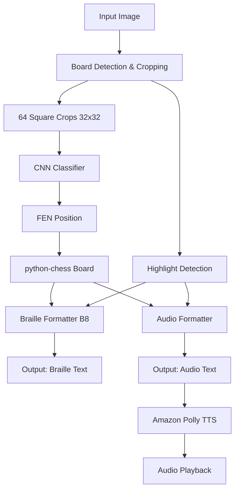
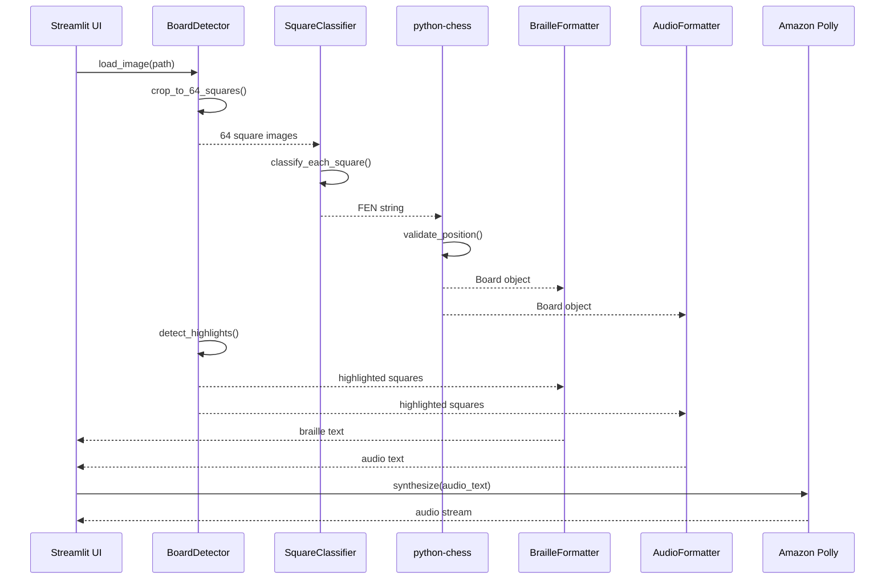

# Design Document: Chess Diagram Transcriber for ONCE

## Overview

Transcribe chess diagram images to ONCE's two official formats: braille notation (B8 Technical Document) and audio description (adapted book format). The system uses a trained CNN to classify each of the 64 board squares independently, then generates format-compliant output matching existing ONCE standards character-by-character.

## Architecture



## Main Algorithm/Workflow



## Core Components

### 1. BoardDetector

**Purpose**: Extract 64 individual square images from board diagram

**Interface**:
```python
class BoardDetector:
    def detect_board(self, image: np.ndarray) -> BoardRegion
    def crop_squares(self, board_region: BoardRegion) -> List[np.ndarray]
    def detect_highlights(self, image: np.ndarray, squares: List[Square]) -> Dict[str, List[str]]
```

**Preconditions**:
- Image is loaded as numpy array (RGB or grayscale)
- Image contains a chess board with 64 distinguishable squares

**Postconditions**:
- Returns exactly 64 square crops in a1-h8 order (white's perspective)
- Each crop is 32x32 pixels
- Highlighted squares detected by color thresholding

### 2. SquareClassifier (CNN Model)

**Purpose**: Classify each square crop into 13 classes

**Classes**: empty, wP, wN, wB, wR, wQ, wK, bP, bN, bB, bR, bQ, bK

**Interface**:
```python
class SquareClassifier:
    def __init__(self, model_path: str)
    def classify_square(self, square_img: np.ndarray) -> str
    def classify_batch(self, squares: List[np.ndarray]) -> List[str]
    def to_fen(self, classifications: List[str]) -> str
```

**Architecture** (PyTorch):
```python
class ChessSquareCNN(nn.Module):
    def __init__(self):
        super().__init__()
        self.conv1 = nn.Conv2d(3, 32, 3, padding=1)  # 32x32 -> 32x32
        self.pool = nn.MaxPool2d(2, 2)                # -> 16x16
        self.conv2 = nn.Conv2d(32, 64, 3, padding=1) # -> 16x16
        self.pool2 = nn.MaxPool2d(2, 2)               # -> 8x8
        self.fc1 = nn.Linear(64 * 8 * 8, 128)
        self.fc2 = nn.Linear(128, 13)
    
    def forward(self, x):
        x = self.pool(F.relu(self.conv1(x)))
        x = self.pool2(F.relu(self.conv2(x)))
        x = x.view(-1, 64 * 8 * 8)
        x = F.relu(self.fc1(x))
        return self.fc2(x)
```

**Preconditions**:
- Model weights loaded from disk
- Input images are 32x32x3 normalized tensors

**Postconditions**:
- Returns classification for each square
- FEN string valid for python-chess

**Fallback**: If PyTorch fails to install in 5 minutes, use scikit-learn MLPClassifier with flattened 32x32x3 = 3072 features.

### 3. BrailleFormatter

**Purpose**: Generate B8 Technical Document notation

**Interface**:
```python
class BrailleFormatter:
    BRAILLE_ROWS = {'1':'⠂','2':'⠆','3':'⠒','4':'⠲','5':'⠢','6':'⠖','7':'⠶','8':'⠦'}
    PIECE_ORDER = ['R', 'D', 'T', 'C', 'A']  # pawns separate
    
    def format_position(self, board: chess.Board, highlights: Dict) -> str
    def format_color_pieces(self, board: chess.Board, color: chess.Color) -> str
    def format_highlights(self, highlights: Dict) -> str
```

**Algorithm**:
```python
def format_position(board, highlights):
    """
    Preconditions:
    - board is valid chess.Board object
    - highlights dict contains 'yellow' and/or 'red' keys with lists of squares
    
    Postconditions:
    - Returns string matching B8 format exactly
    - Piece order: R, D, T, C, A, pawns
    - Row numbers use braille low position (⠂⠆⠒⠲⠢⠖⠶⠦)
    - Pawns show only column+row, no 'P' prefix
    """
    output = []
    
    # White pieces
    white_pieces = format_color_pieces(board, chess.WHITE)
    output.append(f"Blancas: {white_pieces}")
    
    # Black pieces
    black_pieces = format_color_pieces(board, chess.BLACK)
    output.append(f"Negras: {black_pieces}")
    
    # Highlights
    if highlights:
        highlight_text = format_highlights(highlights)
        output.append(highlight_text)
    
    return '\n'.join(output)
```

### 4. AudioFormatter

**Purpose**: Generate adapted book audio description

**Interface**:
```python
class AudioFormatter:
    PIECE_NAMES = {'K':'Rey','Q':'Dama','R':'Torre','B':'Alfil','N':'Caballo','P':'Peón'}
    PIECE_ORDER = ['K', 'Q', 'R', 'B', 'N', 'P']  # Different from braille!
    
    def format_position(self, board: chess.Board, highlights: Dict) -> str
    def format_color_pieces(self, board: chess.Board, color: chess.Color) -> str
```

**Algorithm**:
```python
def format_color_pieces(board, color):
    """
    Preconditions:
    - board is valid chess.Board object
    - color is chess.WHITE or chess.BLACK
    
    Postconditions:
    - Returns string with singular/plural piece names
    - Piece order: Rey, Dama, Torres, Alfiles, Caballos, Peones
    - Conjunction 'y' before last square in each piece group
    - Example: "Torres en C1 y H1"
    """
    pieces = []
    for piece_type in PIECE_ORDER:
        squares = find_squares(board, piece_type, color)
        if not squares:
            continue
        
        name = get_name_with_plural(piece_type, len(squares))
        square_list = format_square_list_with_conjunction(squares)
        pieces.append(f"{name} en {square_list}")
    
    return ', '.join(pieces) + '.'
```

### 5. DatasetGenerator

**Purpose**: Create synthetic training data from example sprites

**Interface**:
```python
class DatasetGenerator:
    def extract_sprites(self, reference_images: List[str]) -> Dict[str, List[np.ndarray]]
    def generate_synthetic_board(self, fen: str, style: str) -> Tuple[np.ndarray, List[int]]
    def create_dataset(self, n_samples: int, style: str) -> Tuple[np.ndarray, np.ndarray]
```

**Two Visual Styles**:
1. **Modern color boards** (tablero1-6.png): green/cream squares, standard pieces
2. **Scanned book diagrams** (diagrama01,02,05,23.png): B&W, hatched dark squares, antique print pieces

**Preconditions**:
- Reference images in ejemplos/ directory
- Ground truth transcriptions in REFERENCIA.md

**Postconditions**:
- Generated dataset covers BOTH visual styles
- Perfect labels (no annotation needed)
- Each sample is 32x32x3 image with integer label 0-12

**Critical**: Dataset MUST include both styles. Model trained on only one fails on the other.

## Data Models

```python
@dataclass
class BoardRegion:
    top_left: Tuple[int, int]
    bottom_right: Tuple[int, int]
    square_size: int
    
@dataclass
class Square:
    position: str  # 'a1' to 'h8'
    image: np.ndarray  # 32x32x3
    color: str  # 'light' or 'dark'
    
@dataclass
class TranscriptionResult:
    braille: str
    audio: str
    highlights: Dict[str, List[str]]
    fen: str
```

## Correctness Properties

**Universal Quantification Statements**:

1. **Square Classification**: ∀ square ∈ board, classifier(crop(square)) ∈ {empty, wP, wN, wB, wR, wQ, wK, bP, bN, bB, bR, bQ, bK}

2. **FEN Validity**: ∀ classifications, python_chess.Board(to_fen(classifications)) raises no exception

3. **Braille Order Invariant**: ∀ color ∈ {WHITE, BLACK}, piece_order(braille_output(color)) = [R, D, T, C, A, pawns]

4. **Audio Order Invariant**: ∀ color ∈ {WHITE, BLACK}, piece_order(audio_output(color)) = [Rey, Dama, Torres, Alfiles, Caballos, Peones]

5. **Braille Row Encoding**: ∀ square, row_number(square) ∈ {1..8} ⟹ braille_row(square) ∈ {⠂,⠆,⠒,⠲,⠢,⠖,⠶,⠦}

6. **Character-by-Character Match**: ∀ reference_diagram ∈ REFERENCIA.md, transcribe(reference_diagram) = reference_transcription

## Verification Strategy

**Validation Set**: 10 reference diagrams with exact transcriptions (REFERENCIA.md)

**Verification Algorithm**:
```python
def verify_accuracy():
    """
    Preconditions:
    - All 10 reference images in ejemplos/ directory
    - All 10 transcriptions in REFERENCIA.md
    
    Postconditions:
    - Returns accuracy metrics: squares correct, diagrams perfect match
    """
    correct_squares = 0
    total_squares = 0
    perfect_diagrams = 0
    
    for image_path, expected_output in REFERENCE_TRANSCRIPTIONS:
        result = transcribe_diagram(image_path)
        
        # Character-by-character comparison
        if result.braille == expected_output.braille:
            perfect_diagrams += 1
        
        # Square-level accuracy from FEN comparison
        expected_board = parse_transcription_to_board(expected_output)
        actual_board = chess.Board(result.fen)
        
        for square in chess.SQUARES:
            if expected_board.piece_at(square) == actual_board.piece_at(square):
                correct_squares += 1
            total_squares += 1
    
    return {
        'square_accuracy': correct_squares / total_squares,
        'perfect_match_count': perfect_diagrams,
        'perfect_match_rate': perfect_diagrams / 10
    }
```

## Error Handling

**Board Detection Failure**: Show error message, allow manual crop adjustment

**Classification Uncertainty**: Log low-confidence squares, proceed with best guess

**Invalid FEN**: Catch python-chess exception, show position as-is with warning

**Highlight Detection**: Optional feature, absence doesn't block transcription

**AWS Polly Unavailable**: DEMO_MODE flag - show text transcription, continue without audio

## Testing Strategy

**Unit Tests**:
- BrailleFormatter output matches B8 format exactly
- AudioFormatter uses correct piece order and singular/plural
- Square classifier returns valid class labels

**Integration Tests**:
- End-to-end pipeline on all 10 reference diagrams
- Verify character-by-character match against REFERENCIA.md

**Property-Based Testing**:
- Generated positions always produce valid FEN strings
- Braille output always uses correct row encoding (⠂⠆⠒⠲⠢⠖⠶⠦)
- Audio output always has conjunction 'y' before last square

## Performance Considerations

- CNN inference on CPU: <100ms per diagram (64 forward passes)
- Synthetic dataset generation: ~1000 boards/minute
- Model training: <10 minutes on CPU for 10K samples
- Streamlit UI: responsive for images up to 2MB

## Security Considerations

- No user authentication required (demo tool)
- Image uploads validated for format (PNG/JPG)
- No persistent storage of uploaded images
- AWS credentials behind DEMO_MODE environment flag

## Dependencies

- **Core**: Python 3.8+, Streamlit, Pillow, OpenCV, numpy
- **Chess Logic**: python-chess (FEN validation, position queries)
- **ML**: PyTorch (fallback: scikit-learn MLPClassifier)
- **Audio**: boto3 + Amazon Polly (optional, behind DEMO_MODE)
- **Dev**: pytest for validation script
