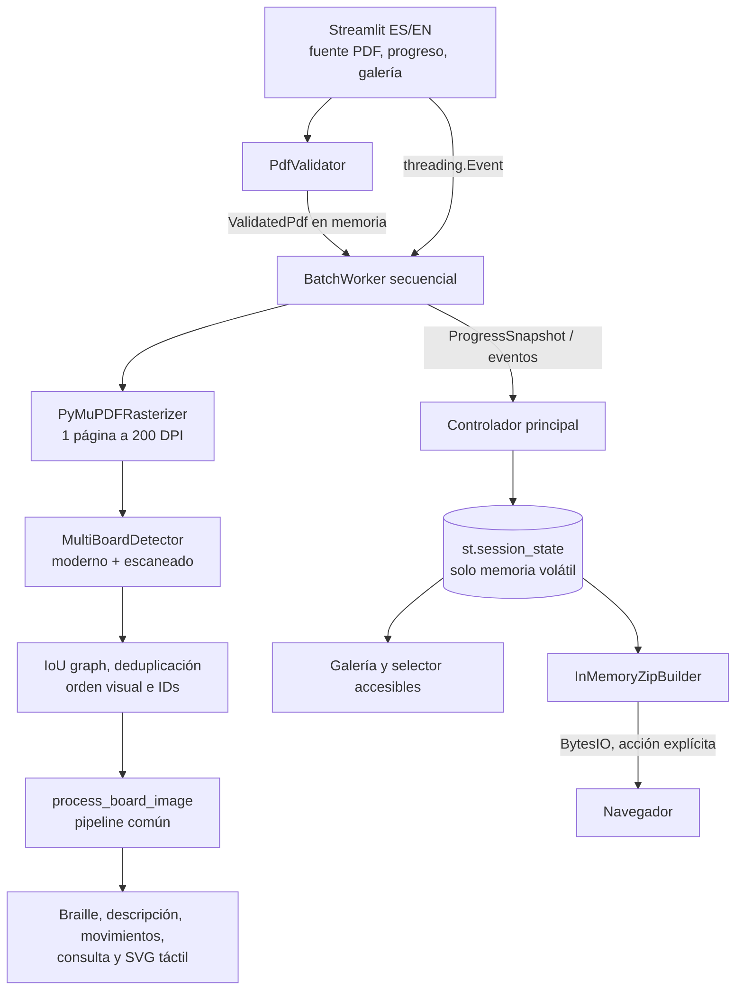

# Design Document

## Overview

`pdf-multi-board-transcription` añade una tercera fuente de entrada a la aplicación Streamlit: un único PDF. El flujo valida el documento completo, rasteriza una página cada vez, detecta y deduplica todos sus tableros, y entrega cada recorte al mismo pipeline usado por PNG/JPG. Los resultados se conservan en una galería de `st.session_state`, se revisan sin reprocesar y solo se materializan fuera de la sesión cuando la persona usuaria solicita un ZIP al navegador.

La implementación se separará de `app.py` en servicios sin UI. `app.py` conservará la composición Streamlit, mientras que la lógica de análisis hoy embebida se extraerá a una función común `process_board_image`; tanto el flujo individual como el PDF la invocarán con la misma imagen y configuración. Esta frontera es la garantía principal de equivalencia.

### Decisiones y hallazgos de investigación

- Se usará **`PyMuPDF==1.26.4`**, fijado exactamente en la futura actualización de dependencias, porque ofrece distribución para Microsoft Windows, requiere Python 3.9 o superior y no necesita un ejecutable externo. La [ficha oficial de PyPI](https://pypi.org/project/PyMuPDF/1.26.4/) documenta plataforma, versión y licencia.
- `pymupdf.open(stream=pdf_bytes)` abre el documento desde memoria y determina el tipo por contenido; `needs_pass`, `is_encrypted`, `is_pdf` y `page_count` permiten validar acceso y enumeración. Véase la [API de Document](https://pymupdf.readthedocs.io/en/latest/document.html).
- `Page.get_pixmap(dpi=200)` fija directamente la resolución de ambos ejes. La [guía oficial de imágenes](https://pymupdf.readthedocs.io/en/latest/recipes-images.html) confirma este uso.
- PyMuPDF tiene licencia AGPL o comercial. Antes de incorporar la dependencia se deberá confirmar que la distribución del proyecto cumple una de esas modalidades; si no, se reevaluará el adaptador `PdfRasterizer` sin cambiar el dominio.
- No se usará OCR, extracción de adjuntos, ejecución de JavaScript, resolución de enlaces ni acceso de red. El motor solo abrirá bytes y rasterizará páginas.

Contenido de fuentes externas resumido y reformulado para cumplir restricciones de licencia.

### Objetivos de diseño

1. Preservar sin cambios observables el flujo PNG/JPG y sus salidas.
2. Producir un registro por página y un registro por tablero, con orden, IDs y errores deterministas.
3. Mantener una sola página rasterizada y una sola inferencia activas, con estimación previa de memoria.
4. Permitir progreso periódico y cancelación cooperativa desde Streamlit sin acceder a `st.session_state` desde el worker.
5. Mantener documento, imágenes, audio y ZIP únicamente en memoria de la sesión.
6. Presentar todos los controles, estados y errores de la feature en español o inglés, conservando Braille B8 literalmente.

## Architecture



### Capas y módulos previstos

- **Presentación (`app.py`)**: añade “Documento PDF” al selector actual, muestra límites, inicia/cancela, sondea progreso, presenta galería/selector y ofrece descarga. La rama existente de imagen conserva sus controles.
- **Dominio (`pdf_batch_models.py`)**: enums, dataclasses e invariantes; no importa Streamlit, PyMuPDF ni OpenCV.
- **PDF (`pdf_services.py`)**: validación y adaptador de rasterización PyMuPDF. Trabaja con `bytes`; nunca recibe ni crea rutas.
- **Detección (`multi_board_detector.py`)**: propuestas modernas/escaneadas, evidencia geométrica 8×8, puntuación, agrupación IoU, selección y orden.
- **Pipeline común (`board_analysis.py`)**: aloja la lógica hoy compartible de `app.py`: estilo/orientación, 64 recortes, k-NN, FEN, conteos, Braille B8, descripción, filas de movimientos y SVG.
- **Orquestación (`pdf_batch_processor.py`)**: worker secuencial, cancelación, aislamiento de fallos, contabilidad de memoria y eventos.
- **Empaquetado (`pdf_batch_export.py`)**: manifiesto y ZIP sobre `io.BytesIO`.

### Flujo de extremo a extremo

1. El radio de fuente muestra una rama PDF distinta. `st.file_uploader(..., type=["pdf"], accept_multiple_files=False)` limita la selección; además se valida que haya exactamente un archivo y que el nombre termine en `.pdf` con `casefold()`.
2. Al recibir bytes nuevos se calcula SHA-256 como identidad interna del documento. Si cambia, el controlador solicita cancelación del lote anterior, incrementa `run_id`, elimina sus objetos y descarta cualquier evento tardío cuyo `run_id` no coincida.
3. Antes de crear el worker, `PdfValidator` comprueba tamaño, magic `%PDF-` dentro de los primeros 1024 bytes, apertura por contenido, `is_pdf`, cifrado/protección, número de páginas y límite. Carga la geometría de cada índice para verificar la enumeración completa, pero no rasteriza.
4. Un `threading.Thread` por sesión recibe bytes, límites, modelos ya cargados, `threading.Event` de cancelación y un canal protegido por `Lock`/`Queue`. El worker no llama a Streamlit ni muta `st.session_state`.
5. Un fragmento `st.fragment(run_every=1.0)` consume eventos y renderiza el último `ProgressSnapshot`; el botón Cancelar hace `cancel_event.set()`. La secuencia del snapshot evita anunciar dos veces el mismo cambio en la región `aria-live`.
6. Por cada página, en índice ascendente, el worker estima memoria, rasteriza a 200 DPI RGB sin alfa, detecta candidatos, deduplica, ordena, recorta y libera matrices intermedias en `finally`. Tras copiar los recortes requeridos, libera la página antes de retener más de una página adicional.
7. Los tableros de la página se procesan uno a uno mediante `process_board_image`. Una excepción solo falla ese tablero; una excepción de rasterización falla esa página. En ambos casos el lote continúa salvo cancelación o límite global.
8. El hilo publica eventos inmutables. Solo el controlador principal los aplica a `st.session_state["pdf_batch"]` y a la galería.
9. La selección de un registro usa el `chess.Board`/FEN ya reconocido para consulta, audio, movimientos y SVG, sin volver a rasterizar ni clasificar.
10. Solo al pulsar Descargar se construyen manifiesto, imágenes y transcripciones en un ZIP `BytesIO`, que `st.download_button` entrega directamente.

### Rasterización incremental y memoria

Las dimensiones se calculan antes de renderizar con la caja física de la página, expresada en puntos PDF:

```text
width_px  = ceil(page.rect.width  / 72 × dpi)
height_px = ceil(page.rect.height / 72 × dpi)
dpi       = max(200, configured_dpi)
pixels    = width_px × height_px
```

Se rechaza la página si `pixels > max_page_pixels`. Antes de cada apertura, rasterización, detección, recorte, análisis y ZIP, `MemoryBudget` estima:

```text
PDF bytes + objetos retenidos + imágenes de tableros + resultados/audio + ZIP actual
+ nueva imagen RGB (width × height × 3)
+ reserva de trabajo del detector (4 × imagen RGB)
+ margen de overhead Python (20 % de lo anterior)
```

Si la estimación excede 1 GiB o el límite desplegado, no empieza la operación, se liberan buffers prescindibles y se crea el error localizado correspondiente. La página RGB, máscaras, contornos y vistas NumPy se eliminan al terminar la detección/recorte; como máximo coexisten la página actual y una página en transición. Los recortes y resultados pueden conservarse mientras quepan; el audio se genera bajo demanda y reemplaza el audio previo del selector. El ZIP se invalida ante cualquier cambio del lote y se conserva solo si fue solicitado.

### Cancelación cooperativa

El worker consulta `cancel_event.is_set()` antes de abrir cada página, antes y después de rasterizar, antes y después de detectar, antes de cada recorte/análisis y antes de construir el ZIP. No se intenta interrumpir una llamada nativa de PyMuPDF ni una inferencia ya iniciada: la solicitud queda visible de inmediato, termina la operación atómica actual y no comienza otra. En el entorno de referencia, el retardo objetivo queda acotado por la operación en curso (máximo esperado de cinco segundos). Al confirmar la cancelación se conservan completados, se marcan `CANCELLED` los registros ya creados que sigan pendientes y no se crean registros especulativos para páginas aún no detectadas. Un `finally` cierra `Document` y libera buffers.

### Detección multi-tablero

La detección no reutiliza `detect_board` sobre la página completa, ya que esa función presupone un solo tablero. Genera candidatos por dos rutas y los valida con una función común:

1. **Moderno**: segmentación tolerante de los colores de casilla conocidos y resaltados, componentes conexos, alternancia tipo damero y contornos rectangulares.
2. **Escaneado**: gris, contraste local/adaptive threshold, líneas morfológicas horizontales/verticales, intersecciones y contornos de marcos oscuros.
3. **Evidencia geométrica común**: cuatro bordes exteriores completos; nueve líneas o transiciones por eje que delimitan ocho intervalos; regularidad de separación; al menos 49 de 64 celdas con evidencia coherente; razón de aspecto próxima a 1:1 y área mínima configurable.
4. **Score determinista `[0,1]`**: 35 % regularidad 8×8, 25 % completitud de bordes, 20 % soporte de 64 celdas, 10 % contraste/alternancia y 10 % geometría. Se exige `score >= 0.70`; cada término se redondea a seis decimales antes de comparar.
5. **Asociación**: dos candidatos de la misma página representan la misma cuadrícula si `IoU >= 0.80` y sus centros y pasos de celda son compatibles dentro de tolerancia. Se crea un grafo no dirigido y cada componente conexa es un `DuplicateGroup`; así la transitividad no depende del orden de entrada.
6. **Deduplicación**: se conserva un candidato por grupo, con mayor confianza; los empates se resuelven por `(page_index, top, left, bottom, right, detector_kind)`.
7. **Orden y extracción**: los ganadores se ordenan por `(page_index, top, left, bottom, right)`, reciben ordinal basado en uno y se recortan con coordenadas enteras sujetas a los límites de la página, incluyendo los cuatro bordes. El ID es `p{page_index:04d}-b{ordinal:03d}` y no incorpora hash, score ni estilo.

**Riesgo de detección:** fondos cuadriculados, tablas y tableros parciales pueden producir falsos positivos; escaneos borrosos, perspectiva, bordes cortados o contraste bajo pueden producir falsos negativos. Los umbrales se fijarán en configuración, se evaluarán con corpus moderno/escaneado y no se relajarán silenciosamente por documento. La vista previa con página, ordinal, coordenadas y confianza permite detectar errores sin prometer edición avanzada, fuera de alcance.

### Seguridad y privacidad

- Todos los servicios operan con bytes/objetos en memoria y no contienen clientes HTTP, telemetría ni resolutores externos.
- El nombre de archivo es metadato de presentación: no se usa como ruta. El ZIP usa nombres derivados de IDs controlados.
- PyMuPDF se invoca únicamente para inspección y `get_pixmap`; no se llaman APIs de JavaScript, formularios, adjuntos, acciones, guardado o extracción de contenido activo. Las URI se ignoran y no se proporciona un `Archive`/resource provider externo.
- El tamaño se verifica antes de abrir; páginas, píxeles y presupuesto se verifican antes de reservar la fase siguiente. Excepciones y mensajes nativos se registran internamente sin mostrar contenido sensible ni trazas.
- Cambio de PDF, reset, finalización/cancelación y cierre de sesión eliminan referencias a bytes, páginas, recortes prescindibles, audio y ZIP. La liberación al cierre depende del ciclo de vida de la sesión de Streamlit y del `finally` del worker; no se promete borrado seguro de RAM administrada.

## Components and Interfaces

### Entrada y controlador Streamlit

```python
class PdfFeatureController:
    def accept_upload(self, name: str, files: tuple[bytes, ...]) -> None: ...
    def start(self, language: Language, options: PipelineOptions) -> str: ...  # run_id
    def cancel(self, run_id: str) -> None: ...
    def drain_events(self, run_id: str) -> tuple[BatchEvent, ...]: ...
    def select_board(self, board_id: str) -> BoardRecord: ...
    def clear(self) -> None: ...
```

Responsabilidades: exclusividad de fuente, claves de widgets únicas, aplicación de eventos solo en el hilo principal, descarte de eventos obsoletos y localización. El estado de dominio almacena códigos/argumentos, nunca textos traducidos; al cambiar ES/EN se vuelven a renderizar etiquetas, estados y errores, pero no Braille.

### Validador y rasterizador PDF

```python
class PdfValidator(Protocol):
    def validate(self, name: str, content: bytes, limits: ProcessingLimits) -> ValidatedPdf: ...

class PdfRasterizer(Protocol):
    def page_geometry(self, document: ValidatedPdf, page_index: int) -> PageGeometry: ...
    def render_rgb(self, document: ValidatedPdf, page_index: int, dpi: int) -> Image.Image: ...
```

`PyMuPdfRasterizer` abre `stream=content` y no acepta rutas. La validación, en orden, comprueba selección/extensión, bytes, tamaño, magic, estructura/tipo, protección (`needs_pass`, `is_encrypted` o metadato de cifrado), `page_count`, límite de páginas y carga de la geometría de todos los índices. Una estructura reparable puede aceptarse si todas las páginas se enumeran; se registra advertencia técnica, no datos del documento. Cada render usa `get_pixmap(dpi=dpi, colorspace=RGB, alpha=False)` y copia a PIL antes de liberar el pixmap.

### Detector y deduplicador

```python
class BoardCandidateGenerator(Protocol):
    def propose(self, page: Image.Image, page_index: int) -> tuple[BoardCandidate, ...]: ...

class MultiBoardDetector:
    def detect(self, page: Image.Image, page_index: int,
               limits: ProcessingLimits) -> tuple[ExtractedBoard, ...]: ...

def intersection_over_union(a: BoundingBox, b: BoundingBox) -> float: ...
def duplicate_groups(candidates: tuple[BoardCandidate, ...], threshold: float = 0.80
                     ) -> tuple[tuple[BoardCandidate, ...], ...]: ...
def visual_order(candidate: BoardCandidate) -> tuple[int, int, int, int, int]: ...
def board_identifier(page_index: int, ordinal: int) -> str: ...
```

Los generadores moderno y escaneado pueden proponer la misma cuadrícula. `MultiBoardDetector` aplica evidencia común, score, componentes conexas, ganador determinista, orden, ordinal y crop. No clasifica piezas.

### Pipeline común de tablero

```python
@dataclass(frozen=True, slots=True)
class PipelineOptions:
    margin: int = 0
    automatic_orientation: bool = False
    manual_rotation: bool = False
    language: Literal["es", "en"] = "es"


def process_board_image(image: Image.Image, options: PipelineOptions,
                        models: ModelBundle) -> BoardAnalysis: ...
```

La función recibe una copia RGB y no conoce si procede de upload, ejemplo o PDF. Conserva los modelos k-NN cargados con `st.cache_resource`, el preprocesado 32×32 gris `/255`, la clasificación de 64 casillas, `to_fen`, `python-chess`, `BrailleFormatter`, descripción ES/EN, movimientos y `build_tactile_svg`. La imagen entregada tiene dimensiones y valores de píxel idénticos al `ExtractedBoard`; no se redimensiona ni recomprime antes de entrar. Un estilo sin evidencia suficiente se registra `UNCLASSIFIED` y produce un error de tablero controlado si no hay selección de modelo fiable.

La consulta sigue usando `submit_query(board.copy(stack=False), text, language)` sobre el `BoardAnalysis` seleccionado. TTS continúa siendo local y bajo demanda; el fallo de TTS no cambia el análisis ni oculta el texto.

### Procesador de lote, progreso y memoria

```python
class BatchProcessor:
    def run(self, document: ValidatedPdf, limits: ProcessingLimits,
            options: PipelineOptions, cancel: threading.Event,
            sink: Callable[[BatchEvent], None]) -> BatchResult: ...

class MemoryBudget:
    def estimate(self, retained: RetainedArtifacts, operation: PlannedOperation) -> int: ...
    def require(self, estimated_bytes: int, limit_bytes: int) -> None: ...
```

`run` es estrictamente secuencial: una página, una detección y una llamada al pipeline cada vez. Publica un snapshot al entrar/salir de cada fase y al menos un heartbeat consumible cada segundo. Las excepciones se convierten en `FeatureError`; nunca salen del worker sin un evento terminal. Los contadores se derivan de registros, no se incrementan en dos lugares.

### Galería accesible

La galería lista IDs en orden visual y un selector enlaza por ID, no por índice mutable. Cada opción incluye ID, página, ordinal, estado y tipo; el detalle tiene encabezado/`aria-labelledby` con el mismo ID. Controles de PDF, inicio, cancelación, selector, consulta, audio y descarga tienen etiquetas visibles únicas y orden natural de teclado. CSS `:focus-visible` ofrece contraste verificable. Una única región `role="status" aria-live="polite" aria-atomic="true"` anuncia una vez cada `sequence` nueva; los errores usan `role="alert"` y un ancla enfocada mediante componente accesible. Braille y descripciones completas siempre permanecen visibles.

### ZIP y manifiesto

```python
class InMemoryZipBuilder:
    def build(self, batch: BatchResult, language: Language,
              limits: ProcessingLimits) -> tuple[bytes, BatchManifest]: ...
```

El ZIP se crea con `io.BytesIO`/`zipfile.ZipFile`, nunca con `tempfile`. Incluye `manifest.json`, cada recorte como PNG y, para tableros completados, Braille, descripción, FEN/clasificaciones, movimientos y SVG en archivos con prefijo de ID. Los fallidos solo aportan imagen si existe y entrada de manifiesto con error; no se inventan transcripciones. El constructor verifica presupuesto mientras añade cada entrada, cierra el ZIP aun ante error y devuelve bytes solo tras éxito completo.

## Data Models

Los enums usan valores estables no localizados:

```python
class ProcessingPhase(str, Enum):
    VALIDATING = "validating"
    RASTERIZING = "rasterizing"
    DETECTING = "detecting"
    PROCESSING_BOARDS = "processing_boards"
    COMPLETED = "completed"
    FAILED = "failed"
    CANCELLED = "cancelled"

class ItemStatus(str, Enum):
    PENDING = "pending"
    PROCESSING = "processing"
    COMPLETED = "completed"
    FAILED = "failed"
    CANCELLED = "cancelled"

class VisualStyle(str, Enum):
    MODERN = "modern"
    SCANNED = "scanned"
    UNCLASSIFIED = "unclassified"
```

### Límites y errores

```python
@dataclass(frozen=True, slots=True)
class ProcessingLimits:
    max_pdf_bytes: int = 50 * 1024 * 1024
    max_pages: int = 100
    raster_dpi: int = 200
    max_page_pixels: int = 40_000_000
    max_feature_memory_bytes: int = 1024 * 1024 * 1024
    duplicate_iou: float = 0.80
    min_detection_score: float = 0.70
    progress_interval_seconds: float = 1.0

@dataclass(frozen=True, slots=True)
class FeatureError:
    code: str
    scope: Literal["document", "page", "board", "audio", "export"]
    page_index: int | None = None
    board_id: str | None = None
    details: Mapping[str, int | float | str] = field(default_factory=dict)
```

Los límites se cargan una vez desde configuración de despliegue, se validan como positivos y se muestran antes de iniciar. `FeatureError.details` contiene solo valores seguros para interpolación localizada, por ejemplo recibido/límite.

### PDF, geometría y candidato

```python
@dataclass(frozen=True, slots=True)
class PageGeometry:
    page_index: int                 # 1..N
    width_points: float
    height_points: float
    width_px: int
    height_px: int

@dataclass(frozen=True, slots=True)
class ValidatedPdf:
    name: str
    sha256: str
    content: bytes
    page_count: int
    geometries: tuple[PageGeometry, ...]
    repaired: bool = False

@dataclass(frozen=True, order=True, slots=True)
class BoundingBox:
    top: int
    left: int
    bottom: int                    # exclusivo
    right: int                     # exclusivo

@dataclass(frozen=True, slots=True)
class GridEvidence:
    horizontal_intervals: int
    vertical_intervals: int
    supported_cells: int
    spacing_score: float
    border_score: float
    cell_score: float
    contrast_score: float
    geometry_score: float
    cell_step_x: float
    cell_step_y: float

@dataclass(frozen=True, slots=True)
class BoardCandidate:
    page_index: int
    box: BoundingBox
    confidence: float
    detector_kind: Literal["modern", "scanned"]
    evidence: GridEvidence
```

Invariantes: índices basados en uno; `0 <= top < bottom <= page_height`; equivalente para columnas; score finito en `[0,1]`; evidencia exactamente 8×8 para un ganador. `BoundingBox` usa límites exclusivos para coincidir con PIL/NumPy.

### Tablero extraído y registro

```python
@dataclass(frozen=True, slots=True)
class ExtractedBoard:
    board_id: str
    page_index: int
    ordinal: int
    box: BoundingBox
    confidence: float
    image: Image.Image             # RGB, copia en memoria

@dataclass(frozen=True, slots=True)
class BoardAnalysis:
    style: VisualStyle
    orientation_degrees: Literal[0, 180]
    classifications: tuple[str, ...]   # longitud 64
    fen: str
    board: chess.Board
    white_pieces: int
    black_pieces: int
    braille_b8: str
    description: str
    move_rows: tuple[Mapping[str, str], ...]
    reliable_moves: bool
    tactile_svg: str

@dataclass(slots=True)
class BoardRecord:
    extracted: ExtractedBoard
    status: ItemStatus = ItemStatus.PENDING
    analysis: BoardAnalysis | None = None
    error: FeatureError | None = None
```

Un registro completado tiene `analysis` y no `error`; uno fallido tiene `error`; pendiente/cancelado no finge resultados. `BoardAnalysis.board` se copia al consultar para que la consulta no mute el registro.

### Página y lote

```python
@dataclass(slots=True)
class PageResult:
    page_index: int
    status: ItemStatus
    geometry: PageGeometry
    board_ids: tuple[str, ...] = ()
    error: FeatureError | None = None

@dataclass(frozen=True, slots=True)
class ProgressSnapshot:
    run_id: str
    sequence: int
    phase: ProcessingPhase
    current_page: int | None
    total_pages: int
    detected: int
    completed: int
    failed: int
    cancel_requested: bool

@dataclass(slots=True)
class BatchResult:
    run_id: str
    document_sha256: str
    phase: ProcessingPhase
    pages: list[PageResult]
    boards: list[BoardRecord]
    zero_board_pages: list[int]
    started_at_monotonic: float
    finished_at_monotonic: float | None = None
    error: FeatureError | None = None
```

En finalización no cancelada, `pages` contiene exactamente un índice único por página. `boards` está siempre en orden visual global y `zero_board_pages` se deriva de páginas completadas con `board_ids == ()`.

### Manifiesto

```python
@dataclass(frozen=True, slots=True)
class ManifestBoard:
    board_id: str
    page_index: int
    ordinal: int
    box: BoundingBox
    status: ItemStatus
    style: VisualStyle | None
    image_path: str | None
    transcription_paths: tuple[str, ...]
    error_code: str | None
    error_details: Mapping[str, int | float | str]

@dataclass(frozen=True, slots=True)
class BatchManifest:
    schema_version: Literal["1"]
    source_name: str
    source_sha256: str
    phase: ProcessingPhase
    page_count: int
    zero_board_pages: tuple[int, ...]
    boards: tuple[ManifestBoard, ...]
```

El JSON usa UTF-8, claves ordenadas y valores de dominio; los textos de error se localizan al presentar, mientras código/detalles permiten reinterpretar el manifiesto. El nombre fuente se neutraliza al serializar y nunca participa en rutas del ZIP.
## Correctness Properties

*A property is a characteristic or behavior that should hold true across all valid executions of a system—esencialmente, una afirmación formal sobre lo que el sistema debe hacer. Las propiedades conectan la especificación legible con garantías de corrección verificables automáticamente.*

### Property 1: Cobertura exacta de páginas

*For any* PDF válido de N páginas que termine sin cancelación y para cualquier patrón de éxitos y fallos recuperables, el lote contiene exactamente N `PageResult`, con índices únicos iguales a `1..N` y cada resultado en estado completado o fallido.

**Validates: Requirements 3.8, 11.1**

### Property 2: Deduplicación independiente del orden

*For any* conjunto de candidatos de una página asociado con K cuadrículas detectables, incluida cualquier cantidad de duplicados y cualquier permutación de entrada, las componentes transitivas con IoU mayor o igual que 0,80 producen exactamente K ganadores en el mismo orden; cada ganador tiene la mayor confianza de su grupo y aplica el Orden Visual como desempate.

**Validates: Requirements 4.1, 4.2, 4.3, 4.4, 4.5, 11.3, 11.4**

### Property 3: Orden, identificadores y galería estables

*For any* conjunto deduplicado de tableros de una o varias páginas, ordenarlo por página, borde superior, izquierdo, inferior y derecho asigna ordinales consecutivos e identificadores derivados solo de página y ordinal, y crea una galería con exactamente un registro por tablero en ese mismo orden.

**Validates: Requirements 4.6, 4.9, 6.1**

### Property 4: Equivalencia entre flujo de imagen y PDF

*For any* imagen de tablero válida y cualquier configuración soportada, si los flujos de imagen y PDF entregan valores de píxel y dimensiones idénticos a `process_board_image` con los mismos modelos y opciones, ambos producen iguales clasificaciones de 64 casillas, conteos, tipo visual, Braille B8, descripción, piezas/movimientos, respuesta a la misma consulta y SVG táctil, con igualdad carácter por carácter donde corresponda.

**Validates: Requirements 5.1, 5.3, 5.9, 11.6**

### Property 5: Aislamiento y continuidad ante fallos

*For any* lote ordenado y cualquier página o tablero que falle, el fallo queda asociado solo a su `PageResult` o `BoardRecord`, los registros ya completados permanecen sin cambios y todos los elementos posteriores no cancelados se intentan en Orden Visual.

**Validates: Requirements 2.8, 5.5, 5.6, 5.7, 6.4, 11.5**

### Property 6: Determinismo del lote

*For any* PDF válido procesado dos veces con bytes, modelos, configuración y límites iguales, la proyección de dominio de ambos resultados —páginas, IDs, coordenadas, orden, estados, tipos, clasificaciones, conteos y transcripciones— es idéntica, excluyendo `run_id` y tiempos monotónicos.

**Validates: Requirements 11.2**

### Property 7: Cero persistencia y procesamiento local

*For any* ejecución del lote sin descarga explícita, la traza de escrituras persistentes y solicitudes de red es vacía; si se solicita descarga, el ZIP se construye íntegramente en memoria y se entrega como bytes al navegador sin abrir ni seleccionar una ruta persistente del servidor.

**Validates: Requirements 7.2, 7.3, 7.6, 7.9, 10.1, 11.7**

## Error Handling

Los servicios lanzan excepciones internas tipadas, y la frontera del worker las convierte inmediatamente en `FeatureError`. La UI localiza `code + details` en ES/EN, muestra el elemento afectado y nunca expone traceback, contenido del PDF, rutas locales ni mensajes nativos sin depurar.

| Código | Ámbito | Tratamiento |
|---|---|---|
| `invalid_selection` / `invalid_extension` | documento | No crea worker; conserva la UI operable. |
| `pdf_too_large` / `page_limit_exceeded` | documento | Rechaza antes de abrir/rasterizar; informa recibido y límite. |
| `invalid_pdf_magic` / `invalid_pdf_structure` | documento | Rechaza antes de rasterizar y cierra cualquier `Document` parcial. |
| `protected_pdf` | documento | Rechaza sin solicitar contraseña ni intentar descifrado; informa fuera de alcance. |
| `empty_pdf` | documento | Rechaza con recuento cero. |
| `page_pixel_limit` / `page_memory_limit` | página | No reserva/renderiza; crea `PageResult.FAILED` y continúa si el presupuesto lo permite. |
| `page_render_failed` / `detection_failed` | página | Libera pixmap/máscaras, registra índice y continúa con la página siguiente. |
| `unclassified_style` / `board_pipeline_failed` | tablero | Marca solo el `BoardRecord`, conserva imagen/error y continúa. |
| `audio_failed` | audio | El registro sigue completado; mantiene descripción/narración visible. |
| `export_memory_limit` / `export_failed` | exportación | Descarta el buffer ZIP incompleto; la galería no cambia. |
| `cancel_requested` | lote | Estado transitorio; deja concluir la operación atómica actual. |
| `cancelled` | lote | Conserva completados, cancela pendientes ya creados, cierra documento y libera intermedios. |
| `internal_error` | lote | Último recurso sanitizado; marca el lote fallido y ejecuta limpieza. |

### Reglas de recuperación

- **Error de documento:** terminal para ese upload y anterior a cualquier rasterización.
- **Error de página:** exactamente un resultado fallido; no crea tableros parciales de esa página.
- **Error de tablero:** no revierte registros previos ni impide procesar IDs posteriores.
- **Ausencia de tableros:** no es error; la página queda completada y aparece en `zero_board_pages`.
- **Error de audio/exportación:** no cambia el análisis reconocido.
- **Error de memoria:** se comprueba antes de la asignación; se sueltan buffers prescindibles y no se inicia la fase rechazada.
- **Cancelación:** es cooperativa, no una excepción asíncrona. Un evento terminal único resuelve carreras entre finalizar y cancelar; gana el primer estado terminal protegido por lock.
- **Limpieza:** cada recurso nativo/ZIP usa context manager y `finally`; eventos de un `run_id` antiguo no pueden repoblar una sesión limpia.

## Testing Strategy

Se adopta un enfoque dual: pruebas unitarias y de integración cubren ejemplos, bordes, UI, biblioteca PDF y recursos; pruebas de propiedades cubren las siete garantías universales. Los tests no entrenan modelos ni realizan red.

### Pruebas unitarias y por ejemplos

- **Validador:** extensión sin distinción de caso, selección múltiple, magic, bytes corruptos, protegido, cero páginas y fronteras `límite-1`, `límite`, `límite+1` para bytes, páginas y píxeles.
- **Geometría/memoria:** A4, Letter, rotación, redondeo por `ceil`, mínimo 200 DPI, estimación antes de cada fase y rechazo previo a asignación.
- **Detector:** IoU, componentes transitivas, score/redondeo, desempate, clamp del crop, K=0 y coordenadas exclusivas. Imágenes sintéticas marcan bordes/píxeles para comprobar el recorte.
- **Orquestador:** máquina de estados, secuencia de eventos, contadores derivados, checkpoints de cancelación, carrera cancelar/completar y descarte de `run_id` obsoleto.
- **Pipeline común:** regresión del preprocesado 32×32 gris `/255`, FEN, conteos, Braille, descripción, movimientos y SVG con los modelos/fixtures existentes.
- **Exportación:** inspección de ZIP en memoria, nombres seguros, JSON UTF-8, registros fallidos sin transcripciones y descarte de buffer incompleto.
- **Localización:** catálogo completo ES/EN, errores con parámetros y Braille idéntico al cambiar idioma.

### Pruebas basadas en propiedades

Se usará **Hypothesis** para Python; no se implementará un generador propio. Cada propiedad tendrá un único test con `@settings(max_examples=100)` como mínimo y generadores acotados por los límites del dominio. Cada test incluirá un comentario con formato exacto:

```python
# Feature: pdf-multi-board-transcription, Property N: <texto de la propiedad>
```

Mapa de implementación:

1. Planes de N páginas y fallos inyectados → Property 1.
2. Candidatos/rectángulos, cadenas IoU y permutaciones → Property 2.
3. Cajas deduplicadas de múltiples páginas → Property 3.
4. Arrays RGB y un pipeline/model bundle determinista fake, más corpus real → Property 4.
5. Secuencias de páginas/tableros y subconjuntos de fallo → Property 5.
6. Dos ejecuciones sobre el mismo plan/documento y proyección sin tiempos → Property 6.
7. Lotes/estados arbitrarios con filesystem, `tempfile`, socket y HTTP espiados → Property 7.

Los generadores evitan llamadas caras a PyMuPDF/modelos para la mayoría de iteraciones mediante adaptadores en memoria. Cada propiedad se complementa con 1–3 pruebas reales representativas; PBT no pretende comprobar comportamiento interno de PyMuPDF, Streamlit ni el sistema operativo.

### Pruebas de integración

- **PyMuPDF Windows/Python:** fixtures PDF mínimo, multipágina, rotado, corrupto, cifrado, con enlace externo, JavaScript y adjunto; validar apertura en memoria, enumeración, RGB a 200 DPI y ausencia de extracción/ejecución/red.
- **Detección real:** corpus etiquetado moderno y escaneado, páginas con cero/uno/varios tableros, duplicados, tablas no ajedrecísticas, bajo contraste, blur y bordes incompletos. Medir precisión/recall por IoU y mantener regresiones explícitas de falsos positivos/negativos.
- **Equivalencia:** recortar una imagen fixture desde PDF sin transformación y compararla contra la misma imagen en el flujo individual; cotejar todos los campos indicados por Property 4.
- **Streamlit:** `AppTest` para fuentes, estados, límites, galería y selección sin reproceso. Playwright más axe-core para recorrido solo teclado, nombres únicos, foco visible, asociación del detalle y una sola actualización `aria-live` por `sequence`.
- **Audio/consulta:** TTS fake valida texto seleccionado y degradación; el controlador real de consulta recibe una copia del `chess.Board` seleccionado.
- **Privacidad:** ejecutar con red denegada y spies sobre `open`, `Path.write_*`, `tempfile` y sockets; fuera de fixtures/modelos de solo lectura, no hay escrituras ni tráfico.
- **Regresión PNG/JPG:** ejecutar el corpus actual contra salidas doradas para demostrar que la nueva fuente no cambia el flujo existente.

### Rendimiento y recursos

En Windows, sobre el Entorno de Referencia, se medirán por separado rasterización A4 y análisis de tablero después de calentar carga de modelos; cada operación deberá completar en cinco segundos. Un lote límite se ejecutará en proceso de prueba aislado para medir RSS pico menor o igual al límite de 1 GiB. Reloj falso verificará polling/heartbeat de un segundo; weakrefs y contadores de buffers verificarán que no coexisten más de dos páginas transitorias y que el estado estable retiene cero páginas completas innecesarias.

Los benchmarks registrarán versión de Python, `PyMuPDF==1.26.4`, CPU, RAM, dimensiones y percentiles. Una revisión de licencia de PyMuPDF es condición de adopción; no es sustituible por un test funcional.
