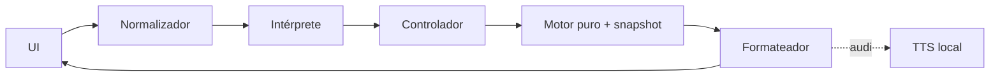

# Documento de Diseño

## Overview
Modo Streamlit de consulta textual ES/EN sobre `analysis_result["board"]`. Al enviar, copia el `chess.Board`; no repite visión. La respuesta queda visible y puede pasar sin cambios a `synthesize_audio`/pyttsx3 y `st.audio`, ya existentes. Sin micrófono, red ni persistencia. [Req. 3.1-3.4, 5.1-5.4]

## Architecture

Núcleo puro, modelos independientes del idioma y fronteras Streamlit/TTS con efectos. El resultado se ordena siempre por `(fila,columna)` ascendente. La sesión guarda solo snapshot, idioma, consulta/respuesta, candidatos y audio. [Req. 1.6, 1.9, 2.3, 5.3-5.6]

## Components and Interfaces
- **Normalizador** `normalize(text)->str`: trim, colapso de espacios y `casefold`; idempotente. [2.1-2.2]
- **Intérprete** `parse(text,lang)->ParsedQuery|Ambiguity|ParseError`: intención y entidades casilla, fila, columna, color, tipo o resumen. [1.1-1.8, 2.3-2.5, 5.7]
- **Motor** `query(snapshot,query)->QueryResult`: usa `piece_at/piece_map`, intersecta filtros, agrega y no muta. [1.1-1.9, 5.1, 5.5-5.6]
- **Formateador** `format(result,lang)->str`: fuente única del texto visible/narrado. [3.1-3.2, 4.4]
- **Controlador UI**: exige Board, resuelve ambigüedad y gobierna envío, repetición, audio, foco, etiquetas y anuncio único. [2.4, 2.6, 3.3-3.4, 4.1-4.4]
- **TTS**: adapta la función local existente; solo se llama con audio activo. [3.2-3.4, 5.2]

## Data Models
`QueryIntent={SQUARE,RANK,FILE,FILTER,SUMMARY}`. `ParsedQuery={intent,square?,rank?,file?,color?,piece_type?}` usa valores python-chess. `PieceMatch={square,piece_type,color}`. `QueryResult={scope,matches[],total,by_color{},by_type{}}`; coincidencias únicas/ordenadas. `Ambiguity` contiene candidatas. Nada se serializa. [Req. 1.5-1.8, 2.4, 5.3-5.6]

## Correctness Properties
### Property 1: Normalización canónica
*For any* texto de consulta, `N` aplica trim, colapso de espacios y normalización de caso, cumple `N(N(x))=N(x)`, y las consultas equivalentes en ES/EN conservan los datos y el orden.
**Validates: Requirements 2.1, 2.2, 2.3**

### Property 2: Resultado exacto
*For any* tablero y consulta válida, el resultado contiene exactamente las piezas que cumplen el alcance y los filtros, sin duplicados y ordenadas por fila y columna.
**Validates: Requirements 1.1-1.6, 1.8, 5.6**

### Property 3: Resumen consistente
*For any* tablero, cada grupo de subtotales del resumen suma el total de piezas correspondiente.
**Validates: Requirements 1.7**

### Property 4: No mutación
*For any* tablero y consulta, la ejecución conserva sin cambios el FEN y el turno del tablero.
**Validates: Requirements 1.9, 5.1**

### Property 5: Determinismo
*For any* instantánea y entrada normalizada, ejecuciones con los mismos valores producen el mismo resultado y orden.
**Validates: Requirements 5.5**

### Property 6: Texto y audio equivalentes
*For any* resultado e idioma, el TTS recibe exactamente el mismo texto que se muestra de forma visible.
**Validates: Requirements 3.1, 3.2, 4.4**

### Property 7: Rechazo
*For any* texto vacío o no admitido, el Motor no se ejecuta.
**Validates: Requirements 5.7**

## Error Handling
Sin Board: pedir analizar sin interpretar. Ambigüedad: mostrar candidatas y esperar. Texto inválido: tipos y ejemplo localizados. Cero: nombrar alcance. Fallo TTS: conservar texto y avisar; audio apagado no llama TTS. [Req. 1.8, 2.4-2.6, 3.3-3.4, 5.7]

## Testing Strategy
`pytest` + `hypothesis`, mínimo 100 casos y una prueba por propiedad, con comentario `Feature: voice-position-query-mode, Property N: ...`. Unitarias: ambigüedad, errores, cero y ES/EN. Mocks: no visión/red/escritura, llamada TTS exacta o ausente. Integración Streamlit: teclado, foco, nombres, anuncio único, repetición y texto permanente. Smoke: estado mínimo y TTS local. PBT cubre solo lógica pura; UI y efectos usan ejemplos/integración. [Req. 2.4-2.6, 3.3-3.4, 4.1-4.4, 5.1-5.4]